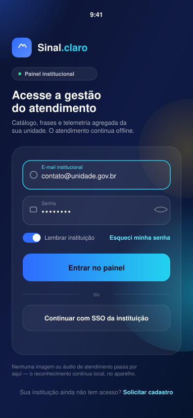

<div align="center">

# Sinal.claro

**Intermediário de comunicação em Libras para atendimentos presenciais.**

Reconhece sinais de Libras pela câmera, 100% no dispositivo — sem internet, sem servidor, sem vídeo saindo do aparelho.

[Visão geral](#-sobre-o-projeto) ·
[Problema](#-o-problema) ·
[Arquitetura](#-arquitetura) ·
[Painel institucional](#-painel-institucional-este-repositório) ·
[Como rodar](#-como-rodar) ·
[Equipe](#-equipe)

</div>

---

## 📖 Sobre o projeto

**Sinal.claro** é um aplicativo móvel desenvolvido como Projeto Integrador do curso de Engenharia de Software da **UniEVANGÉLICA**, pelo grupo **Aether Labs**.

Ele atua como ponte de comunicação em balcões de atendimento — recepções de saúde, secretarias escolares, guichês públicos, farmácias — entre uma pessoa surda usuária de Libras e um atendente ouvinte que não domina a língua.

| Sentido | Como funciona |
|---|---|
| **Libras → Português** | A câmera do celular reconhece um sinal (vocabulário inicial de 50 sinais) e exibe/fala o significado em português. |
| **Português → Libras** | O atendente escolhe uma entre 30 frases frequentes e o app reproduz o vídeo correspondente em Libras, gravado por intérprete. |

Todo o processamento de imagem acontece **no próprio aparelho**. Nenhum quadro de vídeo é salvo ou enviado — o que garante funcionamento sem internet e preserva a privacidade de quem está sendo atendido.

> 📄 A especificação completa (regras de negócio, requisitos, modelo de dados, experimentos técnicos) está em [`docs/especificacao-sinal-claro.pdf`](./docs).

## 🎯 O problema

Balcões de atendimento de alto volume não têm intérprete disponível — o custo e a escassez de profissionais tornam isso inviável na maioria das instituições. Soluções remotas por vídeo dependem de agendamento e internet estável, inviáveis para uma interação de poucos minutos com fila esperando. E as ferramentas de tradução automática mais difundidas no Brasil (VLibras, Hand Talk) traduzem só em um sentido — português para Libras — deixando a pessoa surda sem apoio para se expressar.

O Sinal.claro cobre exatamente essa lacuna: o volume alto de interações curtas e repetitivas do dia a dia de um balcão, nos dois sentidos, sem depender de intérprete humano, conexão ou servidor.

## 🧭 Princípios de projeto

- **Local-first** — reconhecimento, catálogo e vídeos vivem no aparelho; a rede é só para atualizações opcionais de modelo/catálogo e telemetria anônima.
- **Privacidade por padrão** — nenhum quadro de câmera é persistido; o quadro é descartado assim que os pontos de referência da mão são extraídos.
- **Decisão sempre humana** — todo reconhecimento é exibido com grau de confiança e pode ser corrigido manualmente; nunca é aceito silenciosamente.
- **Sem treinamento prévio do atendente** — uma única tela de conversa, botões grandes, zero digitação obrigatória, acessibilidade WCAG 2.2 AA.
- **Não substitui intérprete profissional** — o app avisa seus limites de uso em contextos clínicos, jurídicos ou de decisão sensível.

## 🏗️ Arquitetura

```
┌─ DISPOSITIVO MÓVEL (Android) — funciona sem internet ──────────────┐
│                                                                      │
│  Apresentação → Domínio → Visão (câmera + MediaPipe) ─┐            │
│                               ↓                        │            │
│                         Inferência (TFLite)            │            │
│                               ↓                        │            │
│                       Dados locais (SQLite)            │            │
└───────────────────────────────┬──────────────────────┘            │
                                 ⋮ (opcional, nunca bloqueante)
┌─ SERVIÇO REMOTO (Supabase) ────────────────────────────────────────┐
│  Registro de modelos (versão/hash/catálogo) · Telemetria anônima   │
└──────────────────────────────────────────────────────────────────┘
```

O quadro da câmera nunca passa da camada de Visão — ali ele vira apenas um conjunto de coordenadas (21 pontos por mão) e é descartado. O classificador trabalha sobre essas coordenadas, não sobre imagens, o que mantém o modelo pequeno e rápido o bastante para rodar em um aparelho Android intermediário.

| Camada | Responsabilidade |
|---|---|
| Apresentação | Telas, navegação, acessibilidade, síntese de voz, player de vídeo |
| Domínio | Limiar de confiança, sessão volátil, correção manual, regras de negócio |
| Visão | Captura de câmera + `MediaPipe Hand Landmarker` → pontos de referência |
| Inferência | Janela temporal + atributos → classificador `TensorFlow Lite` quantizado |
| Dados locais | `SQLite` (catálogo de sinais/frases/preferências) + vídeos + modelo |

## 🔐 Painel institucional (este repositório)

> **Importante:** o app de atendimento em si **não tem login**. O aparelho pertence ao ponto de atendimento, não a uma pessoa — usuário surdo e atendente dividem a mesma tela, sem contas nem autenticação (isso está nas regras de negócio da especificação).
>
> O que este repositório traz como primeira peça de interface é a tela de **acesso institucional**: a porta de entrada de um painel de gestão separado, onde a instituição administra o catálogo de sinais/frases, acompanha telemetria agregada e versões de modelo — nunca o atendimento propriamente dito.

<div align="center">
  
</div>

**Destaques da implementação:**
- Fundo com gradiente animado e "orbs" flutuantes (`Animated.loop`), sem dependências pesadas de animação.
- Campos com *floating label*, borda que acende em ciano no foco, e *shake* animado em erro de validação.
- Botão com gradiente, *press feedback* (spring) e estado de carregamento.
- Entrada escalonada (*staggered entrance*) dos elementos da tela.
- Alto contraste e tipografia pensados para WCAG 2.2 AA, coerente com o requisito RNF-004 do produto principal.

## 🧪 Protótipo navegável (`prototipo/`)

Uma apresentação interativa do produto, em HTML puro, que roda direto no navegador:

- **`prototipo/index.html`** — o app de balcão num celular Android, com um guia lateral de 12 passos: abertura, onboarding, conversa, reconhecimento de sinal (câmera real + 21 pontos do MediaPipe, sinal reconhecido simulado), frases em Libras, baixa confiança e correção manual, acessibilidade (alto contraste, tamanho de fonte) e encerramento da sessão. No último passo o celular se transforma num monitor e mostra o painel da instituição.
- **`prototipo/painel.html`** — o painel institucional (login, visão geral, sinais confundidos, limiares, frases, versões do modelo e telemetria anônima). Abrir com `#direto` no fim da URL pula o login.

Para a câmera funcionar, sirva a pasta por HTTP local em vez de abrir o arquivo direto:

```bash
cd prototipo && python3 -m http.server 5500
# abra http://localhost:5500
```

Sem câmera (ou sem permissão), o protótipo entra sozinho no modo simulado.

## 📂 Estrutura do projeto

```
sinal_claro/
├── App.tsx                          # Ponto de entrada — renderiza o login institucional
├── app.json                         # Configuração do Expo
├── prototipo/
│   ├── index.html                   # Protótipo do app de balcão + guia
│   └── painel.html                  # Protótipo do painel institucional
├── docs/
│   └── especificacao-sinal-claro.pdf
└── src/
    ├── theme/
    │   └── colors.ts                # Paleta (alto contraste, WCAG AA)
    ├── components/
    │   ├── AnimatedOrbBackground.tsx
    │   ├── FloatingLabelInput.tsx
    │   └── PrimaryButton.tsx
    └── screens/
        └── InstitutionalLoginScreen.tsx
```

## ⚙️ Stack

| Tecnologia | Uso |
|---|---|
| **React Native + Expo (TypeScript)** | Aplicativo móvel e interface |
| **MediaPipe Hand Landmarker** | Extração dos pontos de referência das mãos |
| **TensorFlow Lite (LiteRT)** | Execução do classificador no dispositivo |
| **Python + TensorFlow/Keras** | Treinamento do classificador temporal |
| **SQLite local** | Catálogo de sinais, frases e preferências |
| **Supabase (PostgreSQL + Storage)** | Registro de modelos e telemetria (opcional) |

> A justificativa de cada escolha tecnológica está na seção 19.1 do documento de especificação.

## ▶️ Como rodar

Pré-requisitos: **Node.js 22+** e o app **Expo Go** no celular (ou um emulador Android/iOS).

```bash
# instalar dependências
npm install

# subir o servidor de desenvolvimento
npx expo start
```

Abra o QR code com o Expo Go, ou pressione `a` (Android), `i` (iOS) ou `w` (web) no terminal.

Comandos úteis durante o desenvolvimento:

```bash
npx tsc --noEmit     # checagem de tipos
npx eslint src App.tsx   # lint
```

## 🗺️ Status atual

Este projeto está na Fase 03 do 4º período. A especificação completa já cobre regras de negócio, requisitos, modelo de dados e experimentos técnicos (classificação com vocabulário reduzido, conversão para TensorFlow Lite, persistência local do catálogo). A integração fim a fim entre câmera, classificador e interface, e a cobertura completa das 50 classes do MVP, seguem em desenvolvimento nos próximos períodos — acompanhe o histórico de versões no início do documento de especificação.

## 👥 Equipe

Projeto desenvolvido pelo grupo **Aether Labs** — Engenharia de Software, UniEVANGÉLICA.

| Integrante | Função |
|---|---|
| José Henrique Sobrinho Santos | Líder técnico — arquitetura, integração do modelo, revisão de código |
| Lucas Moreira de Morais | Desenvolvimento mobile e dados — telas, navegação, câmera, treinamento |
| Emanuel de Andrade Holanda Siqueira | Design, acessibilidade e documentação |

Orientador: **Álvaro Lopes**

---

<div align="center">
<sub>Sinal.claro não substitui intérprete profissional de Libras. Em contextos clínicos, jurídicos ou de decisão sensível, o encaminhamento para atendimento humano especializado é sempre recomendado.</sub>
</div>
